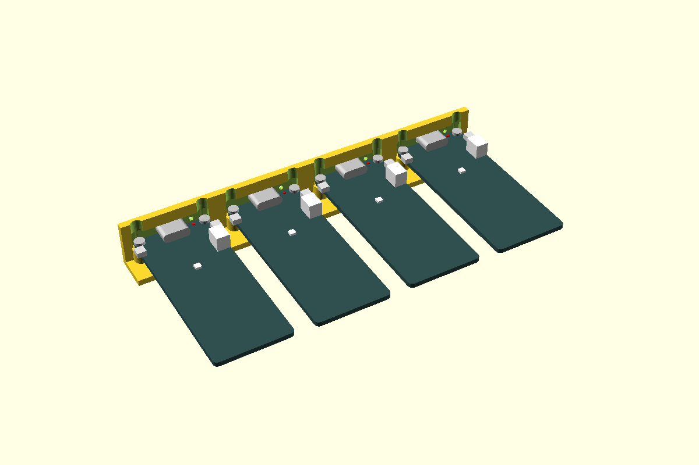

# Hardware library

Printed holders for the parts you buy: an ESP32 board, a USB-C socket, a WAGO connector, a LiPo
pouch, a tactile switch. Each is an OpenSCAD part that gives you the plastic that holds it, the
hole it needs in a wall, and a small **fit piece** to print before it goes into a real box, so the
clearance is set by a print, not a guess. Built and maintained by [Carrier Labs](https://carrierlabs.net).

**Catalogue:** https://carrier-labs.github.io/hardware-library/ — every part in 3D: turn it, cut
it open, slide the board in, download the fit piece.



## Components

| Component | What | Status |
|---|---|---|
| [carrier](components/carrier/) | **The carrier system:** parts sit on small plates on a 10 mm M2.5 grid; a box floor offers only the grid points it uses, a bench plate is the whole grid | measured |
| [snap-hook](components/snap-hook/) | Cantilever hook over a PCB edge: a board with no holes clicks onto its carrier | measured |
| [bridge](components/bridge/) | Snap-on bar between two posts, foam under it: holds a LiPo or anything that can't be hooked | measured |
| [screw-post](components/screw-post/) | Round post for a board's mounting hole: M2 / M2.5 / M3, nut trap or self-tap | measured |
| [usb-c-port](components/usb-c-port/) | USB-C socket flush in a wall, walled in on all sides; the board's end tucks into the wall | measured |
| [board-pocket](components/board-pocket/) | Holder for a board without holes: pedestal + foam tape, outline wall, lid pad maths | measured |
| [firebeetle-esp32e](components/firebeetle-esp32e/) | DFRobot FireBeetle 2 (ESP32-E, S3, C6) on M2 posts, flush USB-C, charge-LED light hole | measured |
| [esp32-c3-supermini](components/esp32-c3-supermini/) | ESP32-C3 Super Mini in a board pocket, flush USB-C | measured |
| [esp32-s3-devkitc](components/esp32-s3-devkitc/) | ESP32-S3 DevKitC-1 (YD clone, Espressif v1.1), one USB port through the wall, the other blanked | measured |
| [rs485-max485](components/rs485-max485/) | TTL-RS485 modules (JZK, XY-017, MAX485 screw-terminal) in a board pocket | measured |
| [rj45-breakout](components/rj45-breakout/) | Pi Hut RJ45 breakout on M2.5 posts, jack flush in the wall | measured |
| [as5600-mount](components/as5600-mount/) | AS5600 encoder board located by its outline at the right height under a magnet | measured |
| [wago-221](components/wago-221/) | Snap clip for WAGO 221 lever connectors, 2/3/5-way, 221-4xx and 221-6xx | measured |
| [lipo-cradle](components/lipo-cradle/) | Low cradle for a pouch LiPo, any cell code (602530…), optional strap bars | measured |
| [neopixel-strip](components/neopixel-strip/) | Cut piece of WS2812B strip behind a window: widths 5–12, any pitch, open/skin/pipe window | measured |
| [tactile-6x6](components/tactile-6x6/) | 6 × 6 tactile switch, stem through a wall: push in and click; every kit height | measured |

**Status** moves one way and says how far a part has been trusted:

- **measured**: dimensions from drawings, STEP or a caliper. Some are marked **CAL**: the fit
  piece decides them.
- **fit-tested**: fit piece printed, clearance chosen, result logged in the part's README.
- **proven**: in a delivered product.

Nothing here is specific to any one product. A part is only added once a real project has needed it.

## Using a part

Pin the library into your project as a git submodule:

```
git submodule add https://github.com/carrier-labs/hardware-library.git lib/hardware-library
cd lib/hardware-library && git checkout <tag>
```

then `use <lib/hardware-library/components/<part>/<part>.scad>`. A part's `.scad` exposes up to
three modules, named after the part, all in the same stated frame:

- **`…Ghost()`**: the component itself, for previews (`%`, so it never renders).
- **`…Holder()`**: the plastic inside the box that holds it.
- **`…Cut()` / `…WallCut()`**: what to subtract from a wall or floor.

All take the clearance as a parameter, defaulting to the fit-tested value. Every dimension is a
named variable with its source in the README, and every part has a sizes table (screw sizes, board
variants, strip widths, cell codes) so the one you have is a name, not a set of numbers.

Before building a box round a part, print its fit piece (`make <part>` → `out/<part>_fit.3mf`):
the holder a few times over at different clearances, marked 1–4 dots. Push the real part into each
and the README's fit table says which dot means which clearance.

## Layout

```
components/<part>/
  <part>.scad   dimensions and modules. Every dimension is a named variable
  fit.scad      the fit piece: the part's holder at a few clearances, marked 1–4 dots
  README.md     what it is, how to use it, dimensions with sources, fit results
  render.png    generated by `make renders`
  catalog.json  its page in the catalogue
  views/        extra models for the catalogue's views
site/           the catalogue's pages; tools/build_site.py fills out/site/
util/           helpers shared by parts (marks.scad: the dot markers)
out/            make output (gitignored)
```

## Build

```
make all            fit pieces, renders, mesh check
make tactile-6x6    one part's fit piece → out/tactile-6x6_fit.{stl,3mf}
make serve          the catalogue on http://localhost:8000
```

Needs an [OpenSCAD development snapshot](https://openscad.org/downloads.html#snapshots) (the
manifold backend; 2025 or later) and `admesh`. The Makefile finds a snapshot in `~/.local/bin/`,
or pass `OPENSCAD=path`. The catalogue is rebuilt and published by GitHub Actions on every push to
`main` (`.github/workflows/site.yml`).

## Adding a part

1. Only add a part once a project has printed it, or print its fit piece first.
2. Copy an existing part folder. Keep the frame conventions (say the origin and axes at the top of
   the `.scad`), name every dimension, cite its source in the README, add a `catalog.json`.
3. `make all`, commit with the render. Tag a release (`vYYYY.MM.DD`) when projects should pick it up.

Measurements and fit results on boards we don't own are the most useful thing you can send: open
an issue or a pull request with the part, what you measured it with, and which dot fitted.

## Licence

[MIT](LICENSE). Don't build on GPL libraries (NopSCADlib is GPL-3): use them as a reference for
dimensions only. MIT ones like YAPP_Box are fine.
