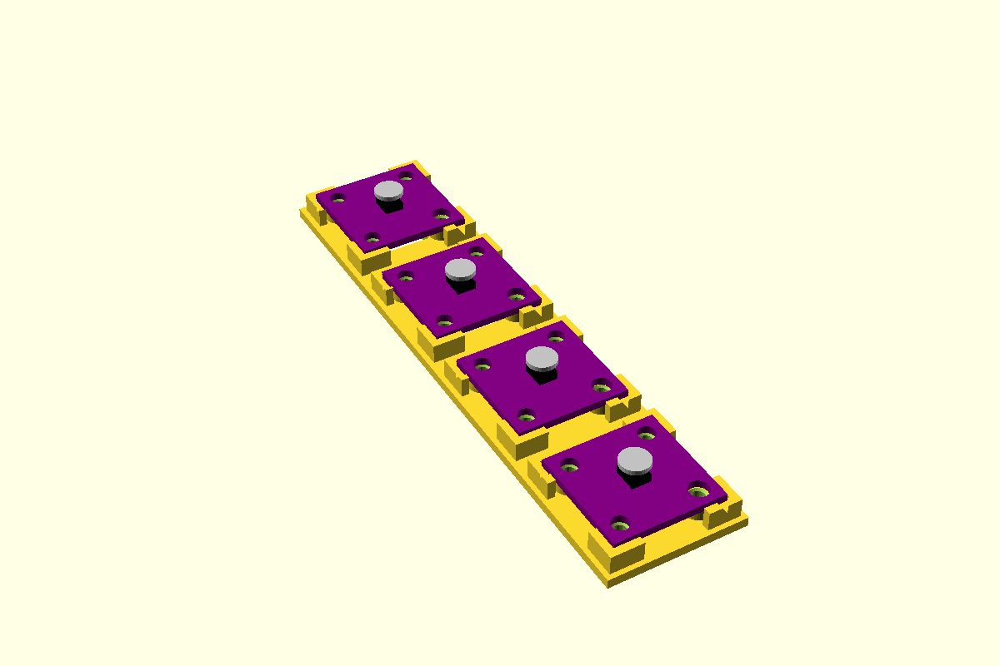

# AS5600 encoder mount

Holds an AS5600 magnetic encoder board flat under a diametric magnet on the end of a spindle.
The AS5600 needs the magnet's axis within **0.25** of the IC's centre, and its face 0.5 to 3
above the package. Two things follow:

- **The outline locates the board, not the holes.** Four corner lips stand round the board's
  edge, so the board can shift only by the lip clearance. The holes are oversize (Ø3.5 and Ø4.0
  for an M2.5) and not placed accurately enough to hold 0.25, so the screws only clamp.
- **The post height comes from the magnet.** `as56PostH(magnetFaceZ)` puts the IC's top `gap`
  (1.5) below the magnet's face. `as56MagnetFaceZ(tipZ, magnet)` gives the face for a magnet
  stuck on a spindle tip.

The four posts are [screw-post](../screw-post/) `"head"`: **stainless** M2.5 screws come up from
below, heads in counterbores in the floor's underside, with a stainless washer and nut on the
board. Carbon steel near the magnet bends its field. Round boards get three arc lips instead of
corners.

First used in the controller project (controller base, two knobs).



**Status:** measured. Fit piece not yet printed.

## Use

```openscad
use <../lib/hardware-library/components/as5600-mount/as5600-mount.scad>

// frame: floor top, on the magnet axis; board edges along X and Y
face  = as56MagnetFaceZ(tipZ = 11, magnet = "6x1");   // 10: magnet face above the floor top
postH = as56PostH(face);                                // 5.15
translate([axisX, axisY, floorTop])
{
  as56Holder(postH);
  if ($preview) as56Ghost(postH, magnet = "6x1");
}
// in the floor's difference():
translate([axisX, axisY, floorTop]) as56FloorCut(floorThick = 2.0, headers = true);
echo(as56Screw(postH));        // 9.85 → M2.5 x 10
echo(as56ScrewTipZ(10));       // 9.4: screw tips, 11.3 off the axis. Keep the spindle clear
```

`headers = true` cuts a 17 × 9 slot under the board for header pins soldered pointing down (out
of the back, away from the magnet). Note the pins then hang below the board: with 5 mm posts,
use wires or cut the pins short.

## Sizes

Boards by name from `as56Boards`, or pass a row of your own in the same layout (`[name, shape,
size, pcb, holes, hole Ø, screw, source]`, holes from the IC's centre). Magnets by name from
`as56Magnets`, or pass the thickness as a number.

| Board | Shape | Holes (from the IC) | Source |
|---|---|---|---|
| `as5600-23` | 23 × 23 × 1.6 | 4 at (±8, ±8): 3 × Ø3.5 + 1 × Ø4.0 (by DIR) | Measured 2026-10-21 (DollaTek B0BGPF3WT3, JYUDAUFU B0DJ77DS4J). 23 × 23 and a 3.7 hole also on [TinyTronics](https://www.tinytronics.nl/en/sensors/magnetic-field/as5600-magnetic-angle-sensor-encoder-module) |
| `as5600-20` | 20 × 13.5 | 2 at (±7.5, 0), M3 | [Vendor listing](https://products-449.pages.dev/en/as5600/v1): 20 × 13.5, M3 × 2 on 15 pitch. **CAL**: PCB, hole Ø, IC centred |
| `round-cal` | Ø20 | 2 at (±7, 0) | **Placeholder**: no source found for a round board. Measure before use |

Not modelled: the Seeed Grove AS5600 (40 × 20, Grove holes; [Botland](https://botland.com.pl/en/sensors/15546-grove-12-bit-magnetic-rotary-position-sensor-encoder-as5600.html)).
Add a row once one is in hand.

| Magnet | Ø × thick | Source |
|---|---|---|
| `6x2.5` | 6 × 2.5 diametric | The size commonly bundled with these boards. **CAL** |
| `6x1` | 6 × 1 diametric | The BOM's separate discs; the controller project's base default. **CAL** which one goes on the spindle |

## Dimensions

From the controller project's parts sheet and `controller-base/controller-base.scad`.

| Variable | Value (mm) | Source |
|---|---|---|
| Board (`as5600-23`) | 23 × 23 × 1.6 | Measured 2026-10-21 |
| Holes | Edges 1.75 in, so centres 3.5 in, 16.0 pitch | Measured 2026-10-21 |
| IC position | Centred on the board | Measured 2026-10-21 |
| `as56IcL` × `as56IcW` × `as56IcH` | 4.9 × 3.9 × 1.75 (SOIC-8, max height) | AS5600 datasheet |
| `as56Gap` | 1.5 | Datasheet range 0.5 to 3; middle of it |
| `as56AxisTol` | 0.25 | Datasheet: magnet axis to IC centre |
| Header rows | 3-pin at 4.70 and 4-pin at 17.91 from one edge (−6.8 and +6.41 from the IC), 2.54 pitch | STEP and photo |
| `as56WasherT` / `as56WasherD` | 0.5 / 6.0 | ISO 7089 M2.5 washer |

## Design values

| Variable | Value | Why |
|---|---|---|
| `as56Clearance` | 0.15 per side | **CAL**: board outline to lips; set by the fit piece. The controller project's base used 0.4 (its `fitClearance`), which lets the board shift more than 0.25 |
| `as56LipWall` / `as56LipLeg` | 1.6 / 5 | Lips at each corner, 5 along each edge |
| `as56LipH` | 1.0 above the PCB underside | Under the PCB top, so nothing snags the board |
| `as56LipArc` | 40° | Round boards: three lips |
| `as56FloorThick` | 2.0 | The M2.5 head counterbore (1.4 head + 0.2) leaves 0.4 |
| `as56HeaderSlot` | 17 × 9 | Clears both header rows; asserts it misses the posts |

## Fit piece

`make as5600-mount` → `out/as5600-mount_fit.3mf`. Four 23 mm mounts on one strip of 2.0 floor,
with 3 mm posts to save plastic (the height isn't under test). Only the lip gap changes.

| Dots | Gap per side |
|---|---|
| 1 | 0.05 |
| 2 | 0.10 |
| 3 | 0.15 |
| 4 | 0.25 |

Checks:
- Does the board drop in square without forcing?
- Once in, can you feel it shift side to side? Every 0.1 of shift moves the IC 0.1 off the
  magnet axis, out of 0.25.
- Screw one down (M2.5 × 8 stainless up from below, washer and nut on top): do the heads sit
  flush underneath, and does the board stay flat?
- Does it come out again without prying the lips?

If the headers are already soldered pointing down, stand the piece on two blocks: the pins come
through the slots. Write the winner into `as56Clearance` and the results table below.

## Results

| Date | Material | Best | Notes |
|---|---|---|---|
| — | | | |
