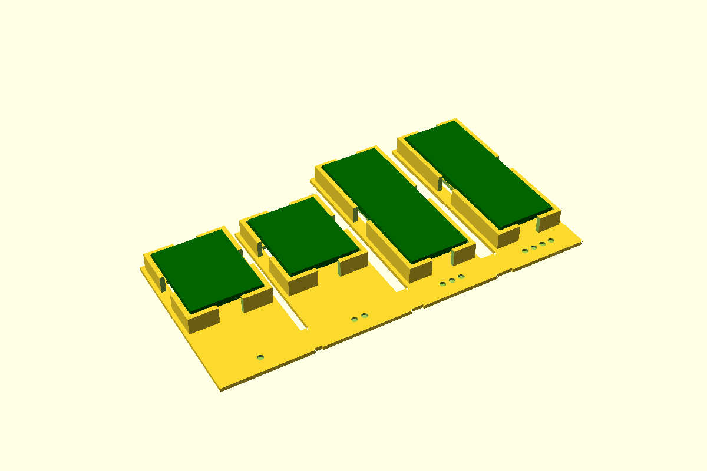

# Board pocket, for boards without holes

Many small modules have no mounting holes. The board sits on a **central pedestal** with a pad
of double-sided foam tape on top, inside a **low wall that follows its outline**. The pedestal
keeps the board's edges off the floor, so lead stubs soldered through the edge holes have room
underneath, and gaps in the wall let the leads out. The wall only locates the board: the tape
holds it down. In a closed box, a **lid pad** presses a pad of foam onto the board as well, so
the lid clamps it and the foam takes up any error in the board's thickness.

It works for any board `l × w × pcb`. Each side of the wall is a lead **gap**, **solid** (where
a plug pushes on the board) or **open** (where the board's end goes into a box wall, as with a
USB port). The ESP32-C3 Super Mini, ESP32-S3 DevKitC and RS485 module parts are built on it.
First used in the controller project (room receiver and rack-ends, 2026-10-30).



**Status:** measured. Fit piece not yet printed.

## Use

```openscad
use <../lib/hardware-library/components/board-pocket/board-pocket.scad>

// frame: floor top, under the centre of the board; X along its length
translate([x, y, floorTop])
{
  boardPocketHolder(l = 43, w = 15.5, pad = [26, 9]);                       // all four sides with lead gaps
  // boardPocketHolder(22.52, 18, [14, 10], ["open", "solid", "gap", "gap"]); // -X end into a wall
  if ($preview) boardPocketGhost(43, 15.5, pcb = 1.6, pad = [26, 9]);
}
boardZ = boardPocketZ();                            // board underside above the floor: 3.5
// lid pad: underside at board top + foam - squeeze. In a YAPP box, YAPP's lidPad at this Z:
padZ = boardLidPadZ(floorTop + boardZ + 1.6);       // + 3.0 - 1.0
// or, in this frame, with lidZ the lid's inner face:
boardLidPad(size = [6, 12.5], at = [15, 0], surfaceZ = boardZ + 1.6, lidZ = 10);
```

`sides` lists `[-X, +X, -Y, +Y]`; `gapW` is one width or one per side. The pedestal `pad`
defaults to the board less `bpPadInset` (4) all round: keep it between the pin rows so the
stubs clear it.

## Sizes

Any board: pass `l`, `w`, `pcb` and the pedestal. The boards built on it so far:

| Board | Outline | Pedestal | Sides |
|---|---|---|---|
| ESP32-C3 Super Mini | 22.52 × 18 | 14 × 10 | open (USB) · solid · gap · gap |
| ESP32-S3 DevKitC (YD clone) | 57.15 × 27.94 | 40 × 14 | open (USB) · solid · gap · gap |
| JZK RS485 module | 43 × 15.5 | 26 × 9 | gap all round (10 at the ends) |

## Dimensions

None of its own: the board's outline and thickness come from the board's part.

## Design values

From the controller project's `receiver.scad` and `rack-end.scad` (`boardPocket()`, lid pads), 2026-10-30.

| Variable | Value | Why |
|---|---|---|
| `bpPedestal` | 2.5 | Floor to the tape: room for lead stubs under the board's edges |
| `bpTape` | 1.0 | **CAL**: the foam tape, and how far it squashes under the board |
| `bpWall` | 1.2 | Outline wall |
| `bpRise` | 1.0 | Wall top above the board's underside. 0.8 under the S3's module overhang |
| `bpClearance` | 0.4 | Per side, outline to wall: PETG. 0.3 for PLA. Set by the fit piece |
| `bpGapW` | 6 | Lead gap in a "gap" side |
| `bpPadInset` | 4 | Default pedestal: the board less this all round |
| `bpFoam` | 3.0 | **CAL**: self-adhesive foam stuck under each lid pad |
| `bpSqueeze` | 1.0 | How far the lid squashes it: about a third for soft foam, 0.3 for felt |

## Fit piece

`make board-pocket` → `out/board-pocket_fit.3mf`. Prints base down, no supports, in the
enclosure's material. The floor is a frame, with windows beside each pedestal, to save plastic.

| Dots | Board | Gap round the outline |
|---|---|---|
| 1 | C3 Super Mini, 22.52 × 18 | 0.3 (PLA) |
| 2 | C3 Super Mini | 0.4 (PETG) |
| 3 | RS485 module, 43 × 15.5 | 0.3 (PLA) |
| 4 | RS485 module | 0.4 (PETG) |

For each: does the board drop in without forcing? Does it sit without more rattle than you'd
like? Stick a pad of tape on the pedestal and press the board down: do its edges stay clear of
the floor, and the lead stubs clear of everything? Can you lift it out by its edges? Write the
winner into `bpClearance` and the results table below. The lid pad's squeeze is tested by the
RS485 part's fit piece.

## Results

| Date | Material | Best | Notes |
|---|---|---|---|
| — | | | |
