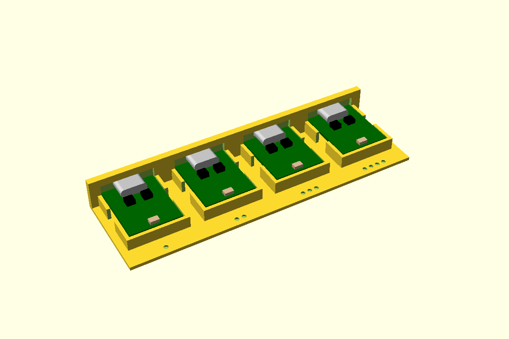

# ESP32-C3 Super Mini, USB-C through a wall

The C3 Super Mini has no mounting holes. It sits on a taped pedestal in an outline pocket
([board-pocket](../board-pocket/)), with its USB-C socket flush in a pocket in the box wall
([usb-c-port](../usb-c-port/)). The pocket is **open at the wall**, where the board's end tucks
into the wall's relief, and **whole at the antenna end**, which takes the plug's push. The long
sides have gaps for the leads. Two lid pads press foam onto it: one across the antenna end, and
a narrow one on the USB-C shell that keeps the foam off the BOOT and RST buttons.

**To fit it:** tip the board nose-down a few degrees, put the socket into the wall, then lay the
antenna end down onto the tape. The socket's height isn't chosen: it follows from the pedestal,
the tape and the PCB (`c3MiniAxisZ`), 6.06 above the floor for a 1.0 PCB.

First used in the controller project (room receiver, 2026-10-30), where the socket came out through a plain
opening; here it's flush.



**Status:** measured. Fit piece not yet printed.

## Use

```openscad
use <../lib/hardware-library/components/esp32-c3-supermini/esp32-c3-supermini.scad>

// frame: floor top, wall inner face, under the socket axis; +X into the box
translate([wallInnerX, usbY, floorTop])
{
  c3MiniHolder(wall = 2.4);
  if ($preview) c3MiniGhost(wall = 2.4);
}
// in the wall's difference():
translate([wallInnerX, usbY, floorTop]) c3MiniWallCut(wall = 2.4);
// on the lid, lidZ = the lid's inner face above the floor top:
translate([wallInnerX, usbY, floorTop]) c3MiniLidPads(wall = 2.4, lidZ = 12);
```

The holder needs about 24 of floor behind the wall's inner face and 21.2 across. The wall's
relief is the board's width.

## Sizes

Pick a row of `c3Variants` with `variant = "..."`, or pass `length` / `pcb` to override one
value.

| Variant | Board | PCB | Note |
|---|---|---|---|
| `supermini` (default) | 22.52 × 18.0 | 1.0 | diymore 4-pack (B0DS23ML1L). PCB **CAL** |
| `supermini-1.6` | 22.52 × 18.0 | 1.6 | Sellers listing a 1.6 PCB |
| `supermini-24` | 24.0 × 18.0 | 1.0 | Longest seller listing (22.5–24). **CAL** |
| `supermini-plus` | 22.52 × 18.0 | 1.0 | SuperMini Plus (V2): same footprint ([mischianti.org](https://mischianti.org/esp32-c3-supermini-plus-v2-high-resolution-pinout-datasheet-and-specs/)). The rest **CAL** |

## Dimensions

From the controller project's parts sheet: S = third-party STEP
([mrtnvgr/KiCad_ESP32-C3-SuperMini](https://raw.githubusercontent.com/mrtnvgr/KiCad_ESP32-C3-SuperMini/master/ESP32-C3-SuperMini.stp)), V = vendor listing.

| Variable | Value (mm) | Source |
|---|---|---|
| Length × width | 22.52 × 18.0 | S, V. **CAL**: sellers vary 22.5–24 |
| PCB | 1.0 | **CAL**: the model says 0.9, some sellers 1.6 |
| USB-C overhang | 1.5 past the edge | S. **CAL** |
| `c3UsbW` × `c3UsbH` | 9.0 × 3.12 | S. The wall pocket uses usb-c-port's 8.94 shell. Height **CAL** |
| `c3ButtonX`, `c3ButtonY`, `c3ButtonH` | 8.8 from the USB edge, ±2.95, 1.7 tall | S |
| `c3PinPitch` | 15.24 between the rows, 2 × 8 at 2.54 | S |
| Antenna | Ceramic chip at the far end; ghost size **CAL** | S |
| Mounting holes | None | S |

## Design values

| Variable | Value | Why |
|---|---|---|
| `c3Pad` | 14 × 10 | Pedestal between the pin rows (controller project's receiver) |
| `c3Sides` | open · solid · gap · gap | Wall end open; the antenna end takes the plug's push |
| `c3PortClear` | usb-c-port's 0.15 | Socket to wall pocket. Set by usb-c-port's fit piece |
| Pedestal, tape, outline gap, wall | 2.5, 1.0, 0.4, 1.2 | board-pocket's defaults |
| Lid pads | 5 across the antenna end; 4 × 5 on the socket | the controller project's receiver. Keeps the foam off BOOT/RST |

## Fit piece

`make esp32-c3-supermini` → `out/esp32-c3-supermini_fit.3mf`. Four holders on one strip of 2.4
wall (set `wall` and `pcb` in `fit.scad` to match). The stations vary how thick the foam tape
ends up once the board is pressed on, which sets the socket's height in its wall pocket.

| Dots | Tape | Outline gap |
|---|---|---|
| 1 | 0.7 | 0.4 |
| 2 | 0.85 | 0.4 |
| 3 | 1.0 | 0.4 |
| 4 | 1.0 | 0.3 |

Stick tape on each pedestal (liner on, to try them all with one board). Tip the board in and
lay it down. Is the socket centred top to bottom in its pocket, face flush outside? Does the
board sit flat? Plug a cable in and pull it out: does the board stay put? Write the winner into
`bpTape` (or pass `tape`) and the results table below.

## Results

| Date | Material | Best | Notes |
|---|---|---|---|
| — | | | |
