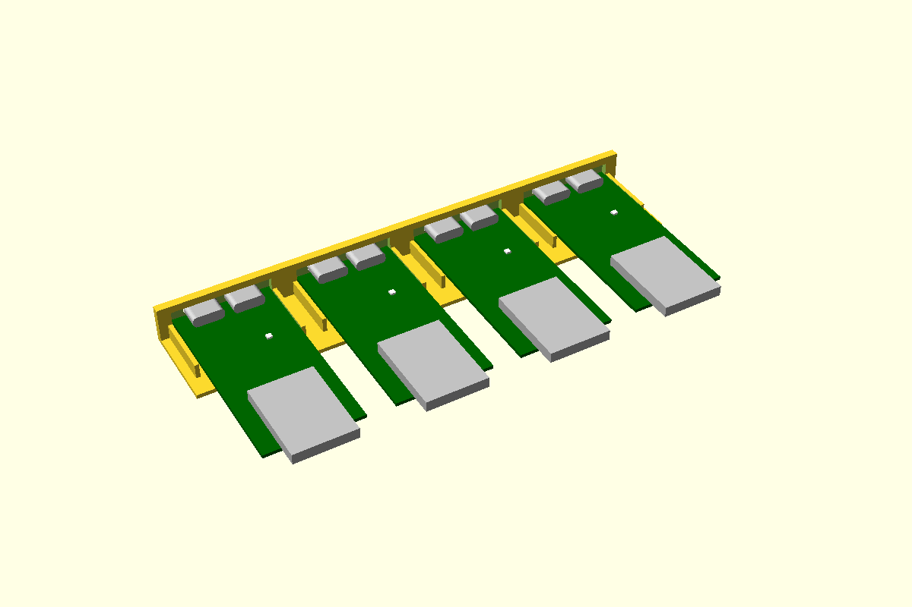

# ESP32-S3 DevKitC, one USB port through a wall

The S3 DevKitC-1, and the YD-ESP32-S3 clone we actually have, has no mounting holes and two USB
ports side by side on its front edge. It sits on a taped pedestal between its pin rows in an
outline pocket ([board-pocket](../board-pocket/)). **Only one port comes through the wall**,
flush in a [usb-c-port](../usb-c-port/) pocket; the other stays behind the wall in a blind
pocket, so nothing gets plugged into the wrong one. `port = "left" | "right"` (seen from
outside) picks which.

The pocket is **open at the wall** and **whole at the back**, under the WROOM module's overhang,
which takes the plug's push. The long sides have gaps for the leads. A lid pad presses foam onto
the module's shield (nothing near the USB end, where BOOT and RST are), and `s3DevkitLedCut()`
makes an optional light hole in the lid over the RGB LED.

**To fit it:** tip the board nose-down a few degrees, put the socket into the wall, then lay the
back end down onto the tape.

The YD's ports overhang the board by only 0.38, so the open port's face sits back 0.62 from the
outside (usb-c-port's `usbcRecess`). The closed port sits just as far forward, so the wall left
in front of it is the recess less the clearance: **0.47**, a single printed line. Pass a bigger
`recess` for a stiffer skin, at the cost of the open port sitting further back: the fit piece
tests 0.8 and 1.0.

First used in the controller project (rack-ends, 2026-10-30), where the port came out through a plain opening.



**Status:** measured. Fit piece not yet printed.

## Use

```openscad
use <../lib/hardware-library/components/esp32-s3-devkitc/esp32-s3-devkitc.scad>

// frame: floor top, wall inner face, under the OPEN port's axis; +X into the box
translate([wallInnerX, usbY, floorTop])
{
  s3DevkitHolder(wall = 2.4);                 // YD clone, right-hand port
  if ($preview) s3DevkitGhost(wall = 2.4);
}
// in the wall's difference():
translate([wallInnerX, usbY, floorTop]) s3DevkitWallCut(wall = 2.4);
// on the lid (lidZ = the lid's inner face above the floor top):
translate([wallInnerX, usbY, floorTop]) s3DevkitLidPad(wall = 2.4, lidZ = 12);
// in the lid's difference():
translate([wallInnerX, usbY, floorTop]) s3DevkitLedCut(wall = 2.4, lidZ = 12, lidThick = 2);
```

The board's left edge (seen from outside) is at `+Y = s3DevkitLeftY()`, so the board spans
`Y = s3DevkitLeftY() - 27.94 .. s3DevkitLeftY()`. The YD holder needs about 62 of floor behind
the wall's inner face (the module overhangs the pocket's back wall) and 31.1 across.

## Sizes

Pick a row of `s3Variants` with `variant = "..."`. N8R2 and N16R8 boards are the same size.

| Variant | Board | PCB | USB | Port centres from the left | Overhang | Module past the back |
|---|---|---|---|---|---|---|
| `yd` (default) | 57.15 × 27.94 | 1.0 **CAL** | 2 × USB-C, 8.94 × 3.2 | 8.2, 19.7 | 0.38 | 6.24 |
| `devkitc-v1.1` | 62.86 × 25.40 | 1.6 assumed | 2 × micro-USB | 6.0, 19.4 **CAL** | 0.87 | 6.29 |

The Espressif v1.1 has micro-USB, which usb-c-port doesn't cover: its wall cut is a plain
12 × 7.5 opening for the plug (**CAL**), with the board's edge 0.2 inside the box. Its LED
position isn't known, so it has no light hole.

## Dimensions

From the controller project's parts sheet and `rack-end/rack-end.scad`. D = drawing,
S = STEP ([YD-ESP32-S3](https://raw.githubusercontent.com/shkuznetsov/YD-ESP32-S3/main/YD-ESP32-S3.step),
[VCC-GND drawing](https://github.com/vcc-gnd/YD-ESP32-S3/blob/main/5-public-YD-ESP32-S3-Hardware%20info/ESP32-S3-Metric.pdf),
[Espressif v1.1 DXF](https://dl.espressif.com/dl/schematics/esp_idf/DXF_ESP32-S3-DevKitC-1_V1.1_20220429.dxf)).

| Item | Value (mm) | Source |
|---|---|---|
| YD board | 57.15 × 27.94 | D (VCC-GND); 57 × 28 on the diymore leaflet |
| YD PCB | 1.0 | S says 1.02. **CAL** |
| YD USB-C | 8.94 × 3.2, overhang 0.38, centres 8.2 and 19.7 from the left seen from the front | S, rack-end.scad |
| Native USB port | `s3Port = "right"` | **CAL** (controller project's rack-end): the one the PC sees as "USB JTAG/serial debug unit" |
| WROOM-1 module | 18 × 25.5 × 3.1, centred across the board, 6.24 past the back edge | Espressif datasheet; overhang S |
| RGB LED (GPIO48) | 19.0 from the USB edge, 8.6 from the left | **CAL**: photo 2026-10-30; STEP says 18.9 |
| Header rows | 25.40 apart, 2 × 22 | D |
| v1.1 board, ports | 62.86 × 25.40; micro-USB centres 6.0 and 19.4, overhang 0.87; module 6.29 past | DXF. Which edge the centres are from: **CAL** |
| Mounting holes | None on either | D, S |

## Design values

| Variable | Value | Why |
|---|---|---|
| `s3Pad` | 40 × 14 | Pedestal between the pin rows (controller project's rack-end) |
| `s3Rise` | 0.8 | Pocket wall above the underside: stays under the module's overhang (PCB top at 1.0) |
| `s3Sides` | open · solid · gap · gap | Wall end open; the back takes the plug's push |
| `s3PortClear` | usb-c-port's 0.15 | Both ports' pockets |
| `s3MinSkin` | 0.4 | Thinnest wall allowed in front of the closed port |
| `s3LedHole` | 5 | Light hole over the LED (controller project's rack-end) |
| Lid pad | 12 × 14 on the module's shield | the controller project's rack-end |
| `s3MicroOpen` | 12 × 7.5, r 2 | **CAL**: plain opening for a micro-B plug (v1.1 only) |

## Fit piece

`make esp32-s3-devkitc` → `out/esp32-s3-devkitc_fit.3mf`. A full holder is over 60 long, so
each station is only the USB end: the wall with both ports and the first 18 of the pocket and
pedestal. Hold the board's far end level while you test. Set up for the YD, right-hand port open,
2.4 wall.

| Dots | Open port's face back from outside | Closed port's skin | Tape |
|---|---|---|---|
| 1 | 0.62 | 0.47 | 1.0 |
| 2 | 0.8 | 0.65 | 1.0 |
| 3 | 1.0 | 0.85 | 1.0 |
| 4 | 0.62 | 0.47 | 0.7 |

Tip the board in and lay it level on the tape (liner on). Is the open socket centred in its
pocket? Plug a cable in: does it seat fully and click with the face that far back? Is the skin
over the closed port whole and stiff, and does that port clear its pocket? Write the winner into
`recess` / `bpTape` and the results table below.

## Results

| Date | Material | Best | Notes |
|---|---|---|---|
| — | | | |
