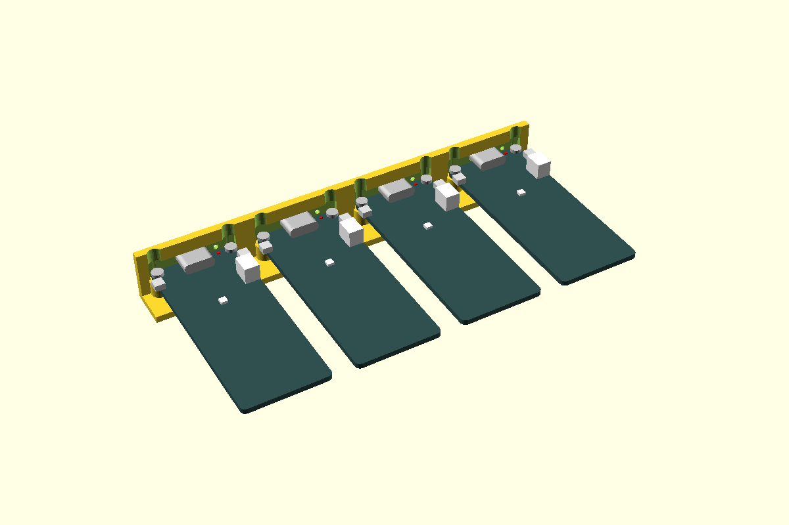

# FireBeetle 2 ESP32-E, USB-C through the wall

DFRobot's FireBeetle 2 ESP32-E (DFR0654) lying flat on four M2 posts, with its USB-C socket
through the box wall. The socket sits in a close-fitting pocket, **walled in on all four sides**,
its face flush with the outside (the [usb-c-port](../usb-c-port/) cut). The board's end tucks into
a shallow relief in the wall's inner face, and the posts are placed from where that puts the
board's edge, so the board **butts right into the wall**. Slide it in over the post tops, socket
first, then screw it down: M2 × 8 button heads from the top into nuts trapped in the floor
(`"nut"`, default), or self-tapping into the posts (`"tap"`).

Two things come with butting the board into the wall:

- The USB-end holes are 0.77 from the wall's inner face, so a screw head (Ø3.5) overlaps the wall
  by about 1 mm and can't come straight down. A shallow **channel** in the wall's inner face lets
  it through, leaving 1.1 of a 2.4 wall. Drive the screws with a 1.3 hex key.
- The red **charge LED** (next to the socket) is now behind the wall. A Ø1.5 **light hole** beside
  the port shows it (`ledHole`, on by default).

First used in the controller project (controller base, 2026-11-02). Replaces the oversized USB opening there.



**Status:** measured. Fit piece not yet printed.

## Use

```openscad
use <../lib/hardware-library/components/firebeetle-esp32e/firebeetle-esp32e.scad>

// frame: floor top, wall inner face, under the socket axis; +X into the box
union()
{
  difference()
  {
    box();                                                   // floor and walls
    translate([wallInnerX, usbY, floorTop])
    {
      fbWallCut("ESP32-E", wall = 2.4, postH = 4.7, channelTop = wallTop - floorTop);
      fbFloorCut("ESP32-E", wall = 2.4, floorThick = 2.0, postH = 4.7);
    }
  }
  // the posts go on AFTER the wall is cut, so the relief doesn't take their tops off
  translate([wallInnerX, usbY, floorTop])
  {
    fbHolder("ESP32-E", wall = 2.4, postH = 4.7);
    if ($preview) fbGhost("ESP32-E", wall = 2.4, floorThick = 2.0, postH = 4.7);
  }
}
axisZ  = fbAxisZ("ESP32-E", 4.7);                  // 7.9: socket axis above the floor
screwL = fbScrewLength("ESP32-E", 2.0, 4.7);       // 8.3 fills the nut; M2 x 8 takes 1.3 of its 1.6
```

`fbHoles(v, wall)` gives the four post positions in this frame, `fbToFrame(v, wall, bx, by)` any
point in the board frame (to place, say, a lid window over the RGB LED). `posts = "usb"` or
`"far"` puts just two of them. Keep the box's side walls clear of the side buttons and the
battery plug (below).

## On a carrier

On the [carrier](../carrier/) grid the same four posts stand on a **7 × 3** plate (70 × 30),
self-tapping, with a **wall lip** across the USB end: a 2.0 × 3.5 bar along the plate's −X edge
that bears on the box wall's inner face. The carrier's Ø2.9 holes give it 0.2 of play on its
screws; the lip takes that out, so the socket lands flush however the screws pull. The plate's
−X edge *is* the wall's inner face: `fbCarrierWallX()` = −35, and the box designer lays the grid
so that line lands on the wall.

```openscad
use <../lib/hardware-library/components/carrier/carrier.scad>
use <../lib/hardware-library/components/firebeetle-esp32e/firebeetle-esp32e.scad>

// floor frame: floor top, under the carrier's centre; the box wall at the carrier's -X edge
translate([x, y, floorTop])
{
  carrierBosses(7, 3);                                          // "tap": add to the floor
  translate([0, 0, crSeatZ()]) { fbCarrier(); if ($preview) fbCarrierGhost(); }
}
// in the floor's and wall's difference():
translate([x, y, floorTop]) carrierFloorCut(7, 3, floorThick, "tap");
translate([x, y, floorTop]) translate([0, 0, crSeatZ()]) translate(fbCarrierAt())
  fbWallCut("ESP32-E", wall = 2.4, channelTop = wallTop - floorTop - crSeatZ());
```

`fbCarrierAt()` = [−35, −0.02, 0] is where this part's frame (wall face, socket axis, floor top)
sits in the carrier's, same axes, so `fbWallCut` goes in the wall at that point with the carrier's
seat added; `fbFloorCut` isn't used. **The carrier is cut for the wall it meets**: the board's
edge lands overhang − wall = −0.93 from the wall face (into the wall's relief, which is what puts
the socket face flush), and the posts follow it. Pass `wall` to `fbCarrier`, `fbCarrierAt` and
`fbWallCut` alike; `fbPostShift` moves the posts as it does on the floor.

**Why 7 × 3.** Across, the holes are 22.0 apart and the posts Ø5: 27, three units. Along, the far
posts reach 59.9 from the wall face, which 6 units would just take, but that puts them 2.6 from
the corner holes, on top of them; at 7 they are 7.7 clear, and the spare 10 at the antenna end is
where the plate's middle hole pair goes. `fbCarrierSize(v, wall)` works this out from the table:
7 × 3 for the whole FireBeetle 2 family at any wall from 2.0 up (a thinner wall moves the USB
posts onto the corner holes and it grows to 7 × 4), 6 × 5 for the old M3 FireBeetle ESP32.

**What holds it.** The board sits on the post tops, 4.7 up, and four **M2 × 6** tap into them:
4.4 of thread, the pilot hole running on 0.2 into the plate (an M2 × 8 would come out
underneath; `fbCarrier` stops with an error and says so). Undo the four and lift it off. The
carrier itself goes into the box with the board on it, slid along the boss tops until the lip
meets the wall and the socket is in its pocket, then its six M2.5 × 6.

**The USB-end posts.** Their holes are 1.7 in from a board edge that is 0.93 inside the wall, so
their axes are 0.77 inside the wall face. On the floor that didn't matter: the posts merged with
the wall. On the carrier a whole post can't exist there, so by default (`usbPosts = "rest"`) that
pair are plain pedestals: the socket's pocket in the wall holds the USB end, as the S3's carrier
does, and the far pair carries the screws. `usbPosts = "tap"` taps all four: the USB-end posts
are then cut off flush with the plate's edge and merged with the lip, and the Ø1.6 pilot hole,
0.8 from its axis, is open to that face by 0.03 (`fbCarrierUsbSkin()`; a 0.4 nozzle leaves about
a 1 mm slit). In the box the wall closes it; on the bench the screw threads into the rest of the
hole. Either way the pair are 4.35 from the corner holes, where an M2.5 head (Ø4.4) would touch
them: each has a Ø5.0 × 1.7 notch for it.

Stack-up above the box floor with the `"tap"` fixing (add 0 for `"nut"` or the bench, which seat
4 lower): plate 4.0–5.6, lip to 9.1, posts to 10.3, board 10.3–11.9, socket 11.9–15.1 (axis
13.5), battery socket to 16.9. The wall's board relief starts at 10.0, so the lip bears on plain
wall. `fbCarrierTop()` 6.3 and `fbCarrierHeight()` 11.3 are above the plate; headers, if fitted,
are not counted.

## Sizes

`fbVariants`, selected by name. All four share the hole layout and the post; the wall cut is
USB-C only.

| Name | Board | SKU | Outline | Holes | USB | Status |
|---|---|---|---|---|---|---|
| `"ESP32-E"` | FireBeetle 2 ESP32-E | DFR0654 | 60.0 × 25.4 | Ø2.0, 1.7 in, 22.0 × 56.6 | C, centred | STEP + drawing, height measured |
| `"ESP32-S3"` | FireBeetle 2 ESP32-S3 | DFR0975 | 60.0 × 25.4 | 22.0 × 56.6 | C, centred | outline/holes from drawing; socket and LED **CAL** |
| `"ESP32-C6"` | FireBeetle 2 ESP32-C6 | DFR1075 | 60.0 × 25.4 | 22.0 × 56.6 | C, centred | outline/holes from drawing; socket and LED **CAL** |
| `"ESP32"` | FireBeetle ESP32 (V3) | DFR0478 | 58.0 × 29.0 | Ø3.1 (M3), 2.5 in, 24 × 53 | **micro-B**, off-centre | posts only: `fbWallCut` asserts. LED is 10 mm in, no light hole |

Free parameters for anything else: `postH` (board height), `how` (`"nut"`, `"tap"`, `"head"`),
`postDia` (default by screw size, M2 Ø5.0), `clearance` (pocket), `postShift`, `ledHole`/`ledDia`.
`"head"` (screw up from below, nut on top) doesn't fit at the USB end of a 2.4 wall: the nut's
channel would leave 0.56 of wall, and `fbWallCut` asserts. A variant can be passed as a list in
the table's format instead of a name.

Sources: DFR0654 [drawing](https://dfimg.dfrobot.com/wiki/23249/DFR0654_firebeetle-2-esp32-e_dimension_v1.0.png)
and STEP (the controller project's parts sheet);
DFR0975 [drawing V1.3](https://dfimg.dfrobot.com/wiki/20529/DFR0975_firebeetle-esp32-s3-ai-acceleration-board_dimension_V1.3.zip);
DFR1075 [drawing](https://dfimg.dfrobot.com/wiki/20576/DFR1075_firebeetle-esp32-c6-microcontroller_dimension_v1.pdf);
DFR0478 [drawing](https://dfimg.dfrobot.com/wiki/19339/DFR0478_firebeetle-esp32-board_dimension_v1.0.png)
and [wiki](https://wiki.dfrobot.com/FireBeetle_ESP32_IOT_Microcontroller(V3.0)__Supports_Wi-Fi_&_Bluetooth__SKU__DFR0478).

## Dimensions

Board frame: component side up, USB end at +Y, origin at the corner at the far (antenna) end.
ESP32-E values unless said.

| Item | Value (mm) | Source |
|---|---|---|
| Board | 60.00 × 25.40 × 1.60, corners R ≈ 1.5 | Drawing, STEP |
| Holes | 4 × Ø2.0 (M2) at 1.70 in; pitch 22.0 × 56.6 | Drawing, STEP |
| USB-C | Centred (x 12.68), overhangs the edge by 1.47 | STEP |
| USB-C shell height | 3.2 | Measured: board + USB-C 4.8 (the STEP says 2.2) |
| Red charge LED (0402) | (20.00, 58.29): 1.71 from the USB edge, 7.32 off the socket's centre | STEP |
| RST / user (IO27) buttons | Side-actuated on both long edges, y 53.23 | STEP |
| PH2.0 battery socket | Opens on the +x long edge, centre y 45.6, top 5.0 above the board | STEP. Plug and cable allowance **CAL** |
| Onboard RGB LED (IO5) | (12.68, 39.09) | STEP |
| Header rows | x 1.27 and 24.13 from y 5.20. Ship loose | STEP, drawing |
| S3 charge LED / buttons / battery | (20.0, 58.0) / y 52.2 / y 44.6 | **CAL**: read off the drawing (P) |
| C6 charge LED / buttons / battery | (19.2, 57.7) / y 52.5 / y 45.4 | **CAL**: read off the drawing (P) |
| S3 / C6 socket overhang, shell | 1.47, 3.2 (as the E) | **CAL**: assumed |
| ESP32 (DFR0478) socket, LED | micro-B at x 9.9, CHG LED (4.8, 47.3) | **CAL**: read off the drawing |

## Design values

| Variable | Value | Why |
|---|---|---|
| `fbPostH` | 4.7 | Board underside above the floor (the controller project's base): M2 × 8 from the top reaches 1.3 into a nut trapped in a 2.0 floor, and pin tails clear underneath |
| `fbHow` | `"nut"` | The screw-post nut trap. `"tap"` is the alternative the fit piece tests |
| `fbClearance` | 0.15 per side | **CAL**: USB pocket, from the usb-c-port fit piece |
| `fbPostShift` | 0 | Posts further from the wall: the socket face sits back by this. Set by the fit piece |
| `fbChannelGap` | 0.3 | Screw-head channel over the head, per side: Ø4.1 |
| `fbLedHoleDia` / `fbLedHoleLift` | 1.5 / 0.2 | Light hole, its bottom just above the board's top, in line with the LED |
| `fbLedReach` | 3.0 | Only cut the light hole when the LED is this close to the USB edge |
| Board's edge | 0.93 into the wall | `usbcBoardEdgeX(2.4, 1.47)`: the socket face flush |
| `fbCarrierWall` | 2.4 | The wall the carrier is cut for: it sets where the board's edge, and so the posts, land from the wall face |
| `fbCarrierScrewLen` | 6 | M2 × 6 into the posts: 4.4 of thread. The pilot runs 0.2 into the plate; an M2 × 8 would come out underneath |
| `fbCarrierLip` × `fbCarrierLipH` | 2.0 × 3.5 | The wall lip: tall enough to square the carrier to the wall, under the board (1.2 clear) and below the wall's relief (0.9 clear) |
| `fbCarrierPad` | 2.0 | Plate kept solid round each post when the plate is opened |
| `fbCarrierHeadGap` | 0.3 | Notch in a post for an M2.5 head beside it: Ø5.0, 1.7 tall |
| `fbCarrierHoleClear` | 0 | A post may stand at a carrier hole's edge (the notch keeps it 1.05 off where the head is); closer, the carrier grows a unit |
| `fbCarrierSkin` / `fbCarrierRunout` | 0.6 / 0.5 | Plate left under a pilot hole; pilot past the screw's tip (as carrier) |
| `fbCarrierBatteryH` | 5.0 | The PH2.0 socket above the board: `fbCarrierHeight()` |

## Fit piece

`make firebeetle-esp32e` → `out/firebeetle-esp32e_fit.3mf`. A strip of 2.4 wall and 10 of floor
with the USB end four times over: pocket, relief, light hole and the two USB-end posts (hold the
board level; the far end isn't needed). Needs four M2 × 8 and three M2 nuts per board you try.

| Dots | Posts | Socket face | Fixing |
|---|---|---|---|
| 1 | nominal | flush | nut |
| 2 | 0.2 further from the wall | 0.2 back | nut |
| 3 | 0.2 closer | 0.2 proud | nut |
| 4 | nominal | flush | tap |

For each: slide the board in, socket first, and screw it down. Do the screws go in without
pulling the board sideways? Which socket face looks flush? Does a cable seat fully? Is the charge
LED visible through the light hole while it charges? On 4, does the screw hold without splitting
the post? Write the winner into `fbPostShift` / `fbHow` and the results table below. The pocket
clearance itself comes from the usb-c-port fit piece.

## Results

| Date | Material | Best | Notes |
|---|---|---|---|
| — | | | |
