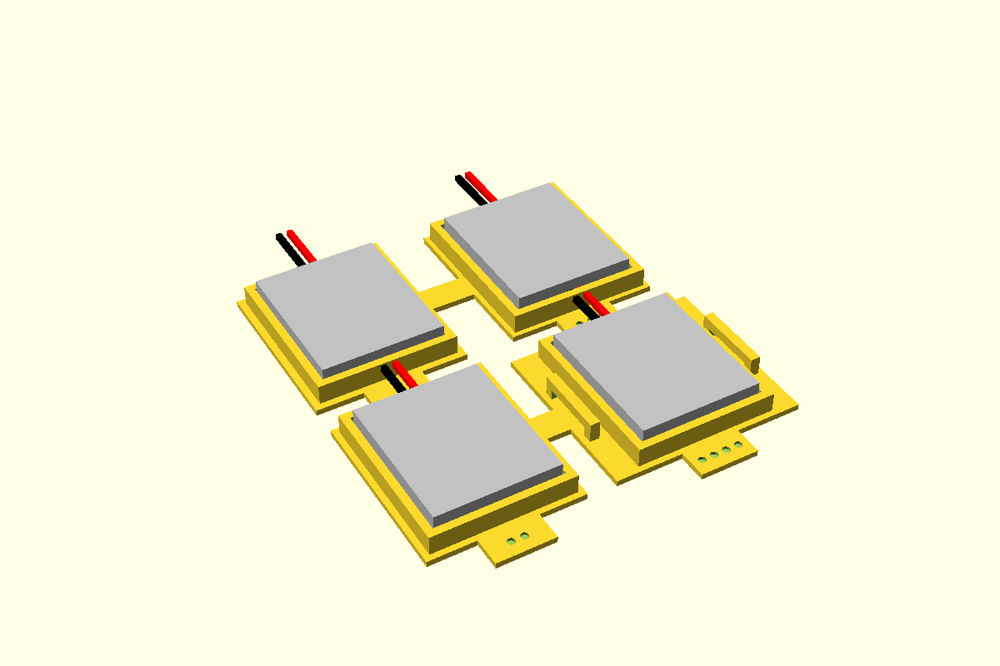

# LiPo pouch cell, low cradle

A low open wall round a LiPo pouch pack, with a gap in one side for the lead. The pack drops
in and the lid keeps it down. If nothing presses on it from above, turn on the **strap bars**:
two bars beside the long walls, raised off the floor, for a hook-and-loop strap. The strap goes
over the pack, down outside the wall, under the bar and back up.

The cradle only locates the pack. Nothing should press on the pouch: leave headroom for it to
swell (`lipoHeadroom()`), and keep it away from sharp edges and screw tips.

First used in the controller project (controller base, 602530 500 mAh pack, 2026-11-02).



**Status:** measured (sizes from the pouch code). Fit piece not yet printed.

## Use

```openscad
use <../lib/hardware-library/components/lipo-cradle/lipo-cradle.scad>

// frame: floor top, centre of the pack's footprint; +X along its length, lead at -X
translate([x, y, floorTop])
{
  lipoCradle("602530", leadSide = "-x");          // strap = 10 adds the strap bars
  if ($preview) lipoGhost("602530");
}
echo(lipoHeadroom("602530"));   // 7.1: the lid must clear this above the floor
```

`leadSide` is `"-x"` (the tab end, default), `"+x"`, `"-y"` or `"+y"`; `gap` sets its width.
`pcm` adds length at the tab end for a protection board that sticks out past the cell.

## Sizes

LiPo pouch cells are named by size: **TTWWLL**, thickness in tenths of a mm, then width and
length in whole mm. 602530 = 6.0 × 25 × 30. Thicknesses of 10 mm and more break the pattern
(103450 is 10 thick, not 1.0), so codes starting with 1 must be in the table. The code is the
**cell**: the pack round it is usually a little bigger. Sellers round the length (±5 % is common),
the protection board is often folded over the tab end, adding a few mm, and the tape adds a few
tenths. The code says nothing about capacity. Measure the pack in hand.

Select by name: a row of `lipoPacks`, or any six-digit code, which `lipoCodeDims()` decodes.

| Name | T × W × L | Note |
|---|---|---|
| `402030` | 4.0 × 20 × 30 | |
| `502030` | 5.0 × 20 × 30 | |
| `602530` | 6.0 × 25 × 30 | 500 mAh, in use in the controller project. Label read 2026-10-30 (the listing's 403048 was wrong). **CAL**: not yet measured |
| `503035` | 5.0 × 30 × 35 | |
| `403048` / `603048` | 4.0 / 6.0 × 30 × 48 | |
| `503450` / `603450` | 5.0 / 6.0 × 34 × 50 | |
| `103450` | 10 × 34 × 50 | 1800–2000 mAh class |
| `902030` | 9.0 × 20 × 30 | |
| `605060` | 6.0 × 50 × 60 | |
| `803860` | 8.0 × 38 × 60 | 2000 mAh class |
| `PKCell-2000` | 8 × 38 × 60 | Pi Hut 105187: vendor size of the pack; lead about 100, JST-PH 2.0. Its code would be 803860, but it isn't on the listing |

Sources: the TTWWLL convention as sellers state it (e.g. Zaitronics 603450, 103450 tables); the
the controller project's parts sheet for the two packs in hand. Everything here is nominal until a pack is measured.

## Design values

| Variable | Value | Why |
|---|---|---|
| `lipoClearance` | 0.4 per side | CAL: pack to wall (controller base `fitClearance`). Set by the fit piece |
| `lipoWall` × `lipoWallH` | 1.6 × 4 | Low wall: locates the pack, easy to lift out (controller base) |
| `lipoLeadGap` | 12 | Gap for the lead and its plug (controller base) |
| `lipoPcmAllow` | 0 | Length added at the tab end for a protection board. CAL per pack |
| `lipoSwell` | 10 % | Headroom over the thickness for a pouch that swells with age. A visibly swollen pack is scrap |
| `lipoTopGap` | 0.5 | Above the swollen pack, under the lid |
| `lipoStrapGap` / `lipoStrapBar` | 2.0 / 2.0 | Strap bars: 2 from the wall and off the floor, 2 × 2 bar. Bridges the strap width + 1 |

## Fit piece

`make lipo-cradle` → `out/lipo-cradle_fit.3mf`. Four cradles for the 602530 on open floor pads.
Prints base down, no supports, in the enclosure's material. Set `name` in `fit.scad` for another
pack, and `pcm` if its protection board makes it longer.

| Dots | Clearance | Strap bars |
|---|---|---|
| 1 | 0.2 | — |
| 2 | 0.4 | — |
| 3 | 0.6 | — |
| 4 | 0.4 | for a 10 wide strap |

For each: does the pack drop in without pressing on the pouch? How far does it slide about? Does
the lead leave through the gap without a sharp bend? On 4: does the strap thread under both bars
and hold the pack down? Write the winner into `lipoClearance` and the results table below.

## Results

| Date | Material | Best | Notes |
|---|---|---|---|
| — | | | |
