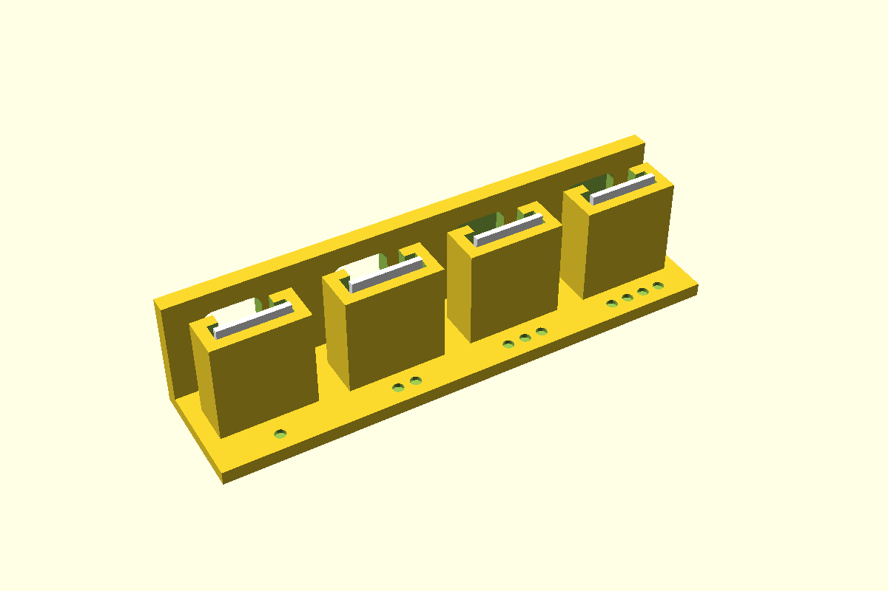

# WS2812B strip piece, behind a window

A cut piece of WS2812B ("NeoPixel") LED strip drops into a slot a few mm back from the box wall,
LEDs facing the wall. A front plate holds it upright, with a window for the light and a lip over
each edge of the strip; the gap to the wall spreads the light. The wall gets one of:

- **open**: a square window with rounded corners, one per LED (the controller base's prototype).
- **skin**: the same window cut from the inside, leaving a thin diffuser skin at the wall's
  outer face, printed with the wall. White or natural plastic glows evenly; no hole to see in.
- **pipe**: a round hole for a light pipe (clear acrylic rod or a printed clear plug).

`bar = true` joins the windows of several LEDs into one slot. The piece either stands **up**
(length vertical, LEDs in a column, as in the controller base) or lies **along** the wall
(length along +Y, width vertical, LEDs in a row). Along, the slot's end walls are cut down to the
middle so the wires can leave the end pads; up, they leave over the top.

First used in the controller project (controller base status light, 2026-11-02).



**Status:** measured. Fit piece not yet printed.

## Use

```openscad
use <../lib/hardware-library/components/neopixel-strip/neopixel-strip.scad>

// frame: floor top, wall inner face, level with the first LED; +X into the box
translate([wallInnerX, ledY, floorTop])
{
  npxHolder(axisZ = 8, name = "10mm-100", length = 15);
  if ($preview) npxGhost(axisZ = 8, name = "10mm-100", length = 15);
}
// in the wall's difference():
translate([wallInnerX, ledY, floorTop]) npxWallCut(axisZ = 8, wall = 2.4, window = "skin");

// three LEDs in a row along the wall, one diffuser bar over them
npxHolder(axisZ = 8, name = "12mm-144", n = 3, along = true, coat = "ip65");
npxWallCut(axisZ = 8, wall = 2.4, name = "12mm-144", n = 3, along = true, window = "skin", bar = true);
```

`axisZ` is the first LED's centre above the floor. The piece rests on the slot's bottom, so the
slot bottom is at `axisZ` less the piece's end-to-LED distance (`ledOffset`, default: the LEDs
centred on the piece). Pass the measured `length` of the piece and, if the LED isn't centred on
it, `ledOffset`. The holder needs about `gap + thickness + 2.4` of floor behind the wall.

## Sizes

**Strip** by name, `"<width>mm-<LEDs per metre>"`. Pitch = 1000 ÷ LEDs per metre; cut on the
copper pads between LEDs, so a piece of `n` LEDs is `n` pitches long (`npxPieceLength(name, n)`).

| Name | Width | LEDs/m | Pitch | LED | Source |
|---|---|---|---|---|---|
| `10mm-30` | 10 | 30 | 33.3 | 5050 | V (BTF-LIGHTING listing) |
| `10mm-60` | 10 | 60 | 16.7 | 5050 | V |
| `10mm-100` | 10 | 100 | 10.0 | 5050 | **In hand**: BTF-LIGHTING B07JBYZRWD, white PCB, IP30. Width and 15 piece measured 2026-10-21 |
| `12mm-74` | 12 | 74 | 13.5 | 5050 | V |
| `12mm-96` | 12 | 96 | 10.4 | 5050 | V |
| `12mm-144` | 12 | 144 | 6.9 | 5050 | V |
| `8mm-60` | 8 | 60 | 16.7 | 5050 | Narrow strips exist; no sample. **CAL** |
| `5mm-160` | 5 | 160 | 6.25 | 2020 | WS2812B-2020 strips; no sample. **CAL** |

**Thickness** (`coat`), back of the strip to the LED's top:

| Name | Thickness | Source |
|---|---|---|
| `"bare"` | 2.13 | V |
| `"ip30"` | 2.4 | Bare with its adhesive tape is about 2.3 (V); 2.4 as in the controller base. Default |
| `"ip65"` | 3.0 | Silicone coat over the LEDs, about 3 (V). **CAL** |

Or pass a number. IP67 strip in a silicone sleeve is wider as well as thicker: measure it and add
a row. The WS2812B 5050 body is 5.0 × 5.0 × 1.57 (5.4 over the pads), from the data sheet.

Add a strip as a row of `npxStrips`: `[name, width, LEDs per metre, LED size]`.

## Design values

| Variable | Value | Why |
|---|---|---|
| `npxClearance` | 0.4 per side | CAL: slot over the strip's width and thickness (controller base `fitClearance`). Set by the fit piece |
| `npxGap` | 5 | LED face to the wall's inner face. 5–10 gives an even glow through a skin (V, blog tests) |
| `npxPlate` / `npxSide` | 1.6 / 1.6 | Front plate; slot side and back walls |
| `npxLip` | 1.5 | Plate left over each strip edge beside the window |
| `npxProud` | 1 | The piece stands this far above the holder, to pull it out |
| `npxWindow` / `npxWindowR` | 8 / 1.5 | Window per LED (controller base prototype) |
| `npxSkin` | 0.6 | CAL: diffuser left at the outer face. 0.4–0.8 white or natural PLA (V, blog tests). Set by the fit piece |
| `npxPipeDia` | 5.2 | CAL: hole for a 5 light pipe |

## Fit piece

`make neopixel-strip` → `out/neopixel-strip_fit.3mf`. Four holders for the 10 mm, 100/m strip in
hand (15 long piece) on a 2.4 wall. Prints base down, no supports, in the enclosure's material:
print it in the colour you'll use, since the skins are the test.

| Dots | Slot clearance | Window |
|---|---|---|
| 1 | 0.2 | open |
| 2 | 0.4 | open |
| 3 | 0.3 | skin 0.4 |
| 4 | 0.3 | skin 0.8 |

For each: does the piece drop in and stand upright without rattling? Can you pull it out by its
top edge? Light it: is the LED centred in the window? On 3 and 4, which glows evenly without a
hot spot, and is it bright enough? Write the winners into `npxClearance` / `npxSkin` and the
results table below.

## Results

| Date | Material | Best | Notes |
|---|---|---|---|
| — | | | |
