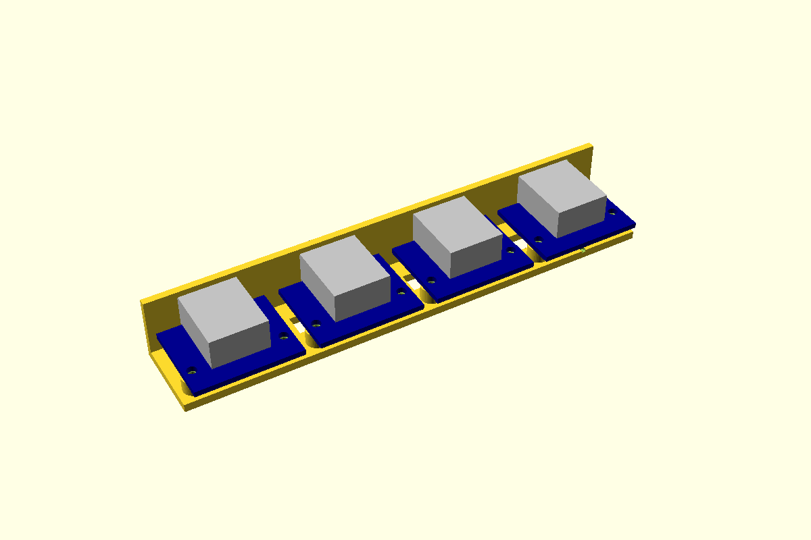

# RJ45 breakout, flush in a wall

A horizontal RJ45 breakout board on two M2.5 screw posts, with its jack through the box wall.
The jack's body sits in a close pocket, **walled in on all four sides**, with its face level
with the outside. The plug's latch comes out of the jack's own face, so nothing on the wall gets
in the way when you press it.

The posts and nut traps are [screw-post](../screw-post/) `"nut"`: M2.5 × 8 in from the top, the
nut in a hex trap in the floor's underside. You slide the board along the post tops, jack first,
into the pocket, then screw it down. The Pi Hut's jack is mid-mount (it drops 1.15 through the
board), so nothing stands in the way on the floor.

How the wall works out depends on the wall against the jack's overhang past the board edge:

- **Wall no thicker than the overhang** (Pi Hut: 2.28 overhang, 2.0 wall): the face is flush and
  the board's edge stops short of the wall (0.28 here).
- **Wall thicker:** the board's end tucks into a shallow **relief** in the wall's inner face, as
  for the [USB-C port](../usb-c-port/). The face is still flush.
- **Relief would leave under `rj45MinWall` (1.0) beside the jack:** the face sits back from the
  outside by `rj45Recess()` instead, and the opening grows by `rj45LatchRoom` on the latch side
  so a thumb still reaches the latch.

First used in the controller project (room receiver, rack-ends, Y-splitter). The controller project's boxes put the board
0.2 off the wall, so their jacks stand 0.08 proud; this part sets them flush.



**Status:** measured (from The Pi Hut's STEP). Fit piece not yet printed.

## Use

```openscad
use <../lib/hardware-library/components/rj45-breakout/rj45-breakout.scad>

// frame: floor top, wall inner face, on the jack's centre line; +X into the box
translate([wallInnerX, jackY, floorTop])
{
  rj45Holder(wall = 2.0);                       // the two posts
  if ($preview) rj45Ghost(wall = 2.0);
}
// in the wall's and the floor's difference():
translate([wallInnerX, jackY, floorTop])
{
  rj45WallCut(wall = 2.0);
  rj45FloorCut(wall = 2.0, floorThick = 2.4);
}
echo(rj45BoardEdgeX(2.0), rj45AxisZ(), rj45Screw());   // 0.28, 8.8, 8.2 → M2.5 x 8
```

Every module takes `postH` (4.2), `board` and `recess`; `rj45WallCut` also `clearance` and
`latch`. `rj45HolesXY(wall)` gives the hole positions in this frame, for a box's own fixings.

## Sizes

Boards are looked up by name in `rj45Boards`; each names its jack in `rj45Jacks`. For a board
not in the table, pass a row of your own as `board` (same layout: `[name, length, width, pcb,
holes, hole Ø, jack, jack offset, screw]`; `jack` may be a name or a row, `screw` any
[screw-post](../screw-post/) size).

| Jack (`rj45Jacks`) | W | Body about the PCB underside | Overhang | Depth | Source |
|---|---|---|---|---|---|
| `pihut-106592` | 16.0 | −1.15 .. 10.35 (mid-mount) | 2.28 | 21.0 | STEP; depth **CAL** |
| `shielded` | 16.0 | 1.6 .. 15.1 (sits on the board) | 2.0 | 21.3 | **CAL**: typical shielded through-hole jack or MagJack (HanRun HR911105A, usually quoted 16 × 13.5 × 21.3) |
| `unshielded` | 15.9 | 1.6 .. 14.6 | 1.0 | 18.3 | **CAL**: typical plastic through-hole jack |

| Board (`rj45Boards`) | Board | Holes | Jack | Screw |
|---|---|---|---|---|
| `pihut-106592` | 23.98 × 29.90 × 1.6 | 2 × Ø2.75 at (7.39, 2.52), (7.39, 27.44) | `pihut-106592`, centred | M2.5 |

Only the Pi Hut board is in hand. The `shielded` and `unshielded` rows are placeholders for the
other common bodies; measure the real board before using them.

## Dimensions

The Pi Hut 106592 RJ45 breakout (horizontal), from The Pi Hut's STEP
([download](https://cdn.shopify.com/s/files/1/0176/3274/files/3D_PCB_RJ45_Horizontal_Breakout_2025-07-30.step)),
measured in the controller project's parts sheet and `common/rj45-breakout.scad`, 2026-10-20.

| Item | Value (mm) | Source |
|---|---|---|
| Board | 23.98 (header edge to jack edge) × 29.90 × 1.6, rounded corners | S |
| Holes | 2 × Ø2.75 (M2.5), 24.92 apart, both 7.39 in from the header edge | S |
| Jack | 16 wide, centred on the board | S |
| Jack overhang past the board edge | 2.28 | S |
| Jack height | 10.35 above and 1.15 below the PCB underside (mid-mount) | S |
| Jack depth | 21 | **CAL**: ghost only |
| Latch side | `rj45Latch` = `"down"` | **CAL**: check which way the jack's latch slot faces. Only matters for a recessed face |
| Header | 8-pin 2.54, along the edge opposite the jack | S |

## Design values

| Variable | Value | Why |
|---|---|---|
| `rj45Clearance` | 0.3 per side | **CAL**: jack to pocket, as in the controller project's boxes. Set by the fit piece |
| `rj45PostH` | 4.2 | Floor top to PCB underside: M2.5 × 8 then ends 0.2 short of the floor's underside, in the nut. Jack bottom 3.05 above the floor |
| `rj45FloorThick` | 2.4 | Takes the M2.5 nut trap (2.0 nut) |
| `rj45PocketR` | 0.5 | Pocket corners, capped at 3 × the clearance so they clear the body's square corners |
| `rj45Chamfer` | 0.3 | Lead-in on the outside edge |
| `rj45MinWall` / `rj45ReliefGap` | 1.0 / 0.3 | Thinnest wall beside the jack where a relief cuts in; relief over the board all round |
| `rj45AboveBoard` | 0.5 | **CAL**: relief height above the PCB, beside the jack |
| `rj45LatchRoom` | 3.0 | Recessed face only: extra opening on the latch side |

## Fit piece

`make rj45-breakout` → `out/rj45-breakout_fit.3mf`. A strip of 2.0 wall (the controller project's receiver and
rack-end) with four pockets, each with its two posts on a ladder of 2.4 floor. Needs two
M2.5 × 8 and nuts per station. Set `wall` in `fit.scad` to the box you'll build.

| Dots | Gap per side |
|---|---|
| 1 | 0.15 |
| 2 | 0.20 |
| 3 | 0.30 |
| 4 | 0.40 |

Checks:
- Slide the board along the post tops into the pocket. Light push, no rattle?
- Do the holes line up with the posts without forcing the board?
- Is the jack's face flush with the outside, with an even gap all round?
- Plug a cable in: does it click? Press the latch: does it come out without catching the wall?

Write the winner into `rj45Clearance` and the results table below.

## Results

| Date | Material | Best | Notes |
|---|---|---|---|
| — | | | |
