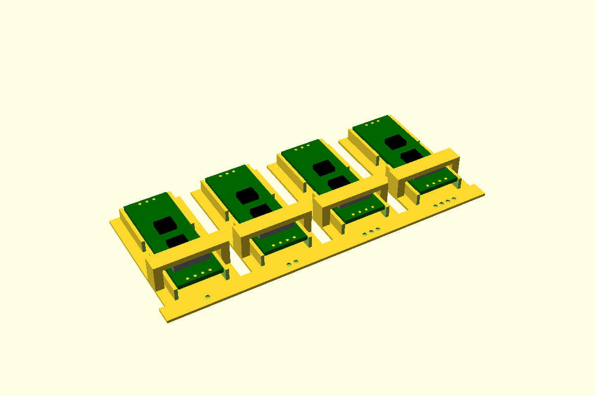

# RS485 module (MAX485), on the floor

A TTL-to-RS485 module. The JZK one we use has no mounting holes, so it sits on a taped pedestal
in an outline pocket ([board-pocket](../board-pocket/)). There are lead gaps at the **bus end**
(A+, B−, earth) and the **logic end** (VCC, TXD, RXD, GND), 10 wide so a 4-pin row's wires
fit through, and 6 wide in both long sides. In a closed box two lid pads press foam onto it, one
inboard of each end's pin row. With a screw terminal, the bus-end pad moves inboard of it.

There's no wall port: the leads go wherever the box takes them. First used in the controller project (room
receiver and rack-ends, 2026-10-30).



**Status:** measured. Fit piece not yet printed.

## Use

```openscad
use <../lib/hardware-library/components/rs485-max485/rs485-max485.scad>

// frame: floor top, under the centre of the board; bus end at -X
translate([x, y, floorTop]) rotate([0, 0, a])
{
  rs485Holder();                    // JZK
  if ($preview) rs485Ghost();
}
// on the lid (lidZ = the lid's inner face above the floor top):
translate([x, y, floorTop]) rotate([0, 0, a]) rs485LidPads(lidZ = 12);
echo(rs485Top());                   // board top above the floor: 5.1
```

The holder takes 46.2 × 18.7 of floor. `sides` works as in board-pocket if a side needs to be
solid or open.

## Sizes

Pick a row of `rs485Variants` with `variant = "..."`.

| Variant | Board | PCB | Pins (bus / logic) | Source |
|---|---|---|---|---|
| `jzk` (default) | 43.0 × 15.5 | 1.6 **CAL** | 3 holes / 4 holes, no terminal | Measured 2026-10-21 (JZK 5-pack, B09VGJCJKQ) |
| `xy-017` | 42.8 × 15.22 | 0.8 | 3 / 4 **CAL** | [WINGONEER XY-017 manual](https://manuals.plus/asin/B06XHH6B6R). Looks like the JZK's family |
| `max485` | 44.0 × 14.0 | 1.6 **CAL** | 4-pin header each end, 2-way 5.08 screw terminal at the bus end | Most listings, e.g. [Kunkune](https://kunkune.co.uk/shop/communication-boards/max485-ttl-to-rs-485-converter-module/), [ElectroPeak](https://electropeak.com/ttl-rs485); some say 45 × 15 or 46 × 12. Terminal size and place **CAL** |

The `max485` is the classic blue module with RO, RE, DE and DI to drive by hand; the other two
switch direction themselves.

## Dimensions

JZK from the controller project's parts sheet (measured and photographed 2026-10-21).

| Item | Value (mm) | Source |
|---|---|---|
| Board | 43 × 15.5 | Measured 2026-10-21 |
| PCB | 1.6 | **CAL**, probably 1.6. The XY-017 manual says 0.8 for its board |
| Holes | None | Photo |
| Bus end | A+, B−, earth: 3 bare plated holes, no screw terminal fitted | Photo |
| Logic end | VCC, TXD, RXD, GND: 4 holes at 2.54, unpopulated | Photo |
| `rs485PinEnd` | 1.5 from the end to the pin row | **CAL**, ghost only |
| Tallest part | About 2 (SMB diodes, SOIC chips) | Photo |
| Chips | MAX485 ESA + CD4069. A MAX485 is rated 4.75–5.25 V: the controller project runs it at 3.3 V on bench tests | Photo |
| Termination | 120 Ω, by shorting the R0 (R13) pads. Meter A+ to B− | Listing, photo |

## Design values

| Variable | Value | Why |
|---|---|---|
| `rs485PadEnd`, `rs485PadSide` | 8.5, 3.25 | Pedestal stops this far in from the ends and sides: 26 × 9 on the JZK, clear of the pin stubs (controller project) |
| `rs485EndGap` | 10 | The 4-pin row is 7.62 across, plus the wires. The controller project used 6 |
| `rs485SideGap` | 6 | As the controller project |
| `rs485PadInset`, `rs485PadLen` | 6, 6 | Lid pads 6 long, 6 inboard of each end, the board's width less 3 (controller project) |
| Pedestal, tape, outline gap, wall, foam | 2.5, 1.0, 0.4, 1.2, 3.0 squeezed 1.0 | board-pocket's defaults |

## Fit piece

`make rs485-max485` → `out/rs485-max485_fit.3mf`. It tests the lid hold-down: four JZK pockets,
each with a bridge across it where the logic-end lid pad would be. Stick a 3 mm foam pad under
each bridge. The stations vary how far the foam gets squashed, so they also show up a PCB
thinner or thicker than 1.6. The ends are open so the board can slide in under the foam; the
real holder has end walls. Prints base down, no supports (the bridges span about 20).

| Dots | Foam squeeze |
|---|---|
| 1 | 0.5 |
| 2 | 1.0 |
| 3 | 1.5 |
| 4 | 2.0 |

Put tape on the pedestal with its liner on and slide the board in from the bus end. Can you,
without forcing? Does the foam hold it firmly without bowing the board? Does it stay put when
you tug it? Does the foam spring back afterwards? Write the winner into `bpSqueeze` (or pass
`squeeze`) and the results table below. The outline gap is tested by board-pocket's fit piece.

## Results

| Date | Material | Best | Notes |
|---|---|---|---|
| — | | | |
