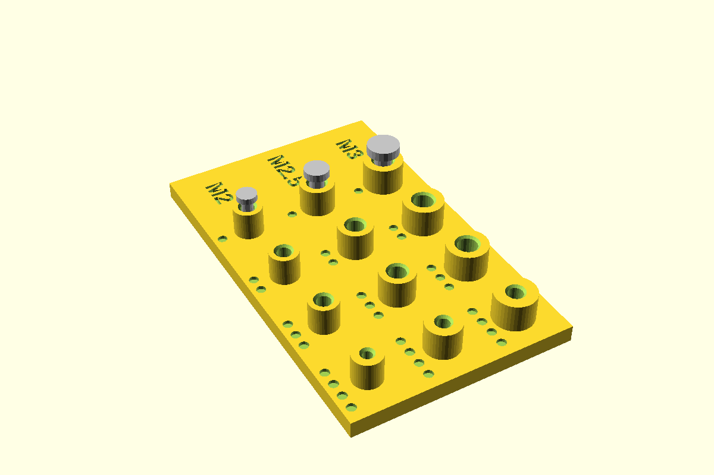

# Screw post, M2 / M2.5 / M3

A round post off the floor for a board with mounting holes. Two ways to fix it:

- **`"nut"`**: a clearance hole through the post and floor, with the nut in a hex trap in the
  floor's underside. The screw goes in from the top. Use this for anything you'll undo.
- **`"tap"`**: a blind pilot hole that the screw cuts its own thread in. Fine for one or two
  fittings in PLA or PETG, and the floor stays whole underneath.

There's also `"head"`, for a screw up from below with its head in a counterbore and the nut on
top. The AS5600 uses this: stainless screws, kept away from the magnet.



**Status:** measured (nominal ISO sizes). Fit piece not yet printed.

## Use

```openscad
use <../lib/hardware-library/components/screw-post/screw-post.scad>

// frame: floor top, on the post's axis
translate([x, y, floorTop]) screwPost("M2", h = 4.7);
// in the floor's difference():
translate([x, y, floorTop]) screwPostFloorCut("M2", floorThick = 2.0);
// which screw reaches: board top to nut underside
echo(screwPostScrew("M2", h = 4.7, floorThick = 2.0, clamp = 1.6));   // 8.3 → M2 x 8 ends 0.3 inside the nut
```

## Dimensions

| Size | Nut (AF × thick) | Button head Ø × h | Post Ø | Tap hole | Floor for a trap |
|---|---|---|---|---|---|
| M2 | 4.0 × 1.6 | 3.5 × 1.1 | 5 | 1.6 | 2.0 |
| M2.5 | 5.0 × 2.0 | 4.4 × 1.4 | 6 | 2.1 | 2.4 |
| M3 | 5.5 × 2.4 | 5.7 × 1.65 | 7 | 2.5 | 2.9 |

Sources: ISO 4032 nuts, ISO 7380 button heads. The M2.5 head is 4.4, as measured on the kit
(B0H2DK4KJ7) for the controller base.

## Design values

| Variable | Value | Why |
|---|---|---|
| `screwNutClear` | 0.3 | CAL: across flats over the nut. Set by the fit piece |
| `screwTapClear` | 0.0 | CAL: added to the tap hole. Set by the fit piece |
| `screwHoleClear` | 0.4 | Clearance hole over the screw |
| `screwHeadClear` | 0.6 | Counterbore over the head |

## Fit piece

`make screw-post` → `out/screw-post_fit.3mf`. A row per size, M2 at the front, with the size
engraved at the start of each row.

| Dots | Kind | Nut clearance |
|---|---|---|
| 1 | nut trap | 0.2 |
| 2 | nut trap | 0.3 |
| 3 | nut trap | 0.4 |
| 4 | tap post | — |

Checks:
- Does the nut push in and stay, sitting flush?
- Does the screw pull the nut up without it spinning?
- Does the tap post take a thread without splitting?

## Results

| Date | Material | Best | Notes |
|---|---|---|---|
| — | | | |
