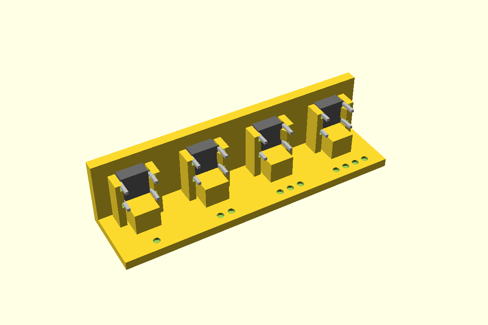

# 6 × 6 tactile switch, through a wall

A 6 × 6 tactile push switch lying on its side, stem out through a plain round hole in the box
wall. **Push in and click:** set the switch down on its seat a few mm back from the wall, legs to
the sides, and push it forward. The stem goes into the hole, the body pushes two flexing cheeks
apart, and their triangular teeth snap in behind it. The teeth then take the press.

`standoff` moves the switch back from the wall, so a longer-stemmed switch stands no further
proud: `tact6x6Proud(wall, standoff)` gives how far the stem stands out. First used in the controller project
(controller base, 2026-11-02).



**Status:** measured. Fit piece not yet printed.

## Use

```openscad
use <../lib/hardware-library/components/tactile-6x6/tactile-6x6.scad>

// frame: floor top, wall inner face, under the stem axis; +X into the box
translate([wallInnerX, buttonY, floorTop])
{
  tact6x6Holder(axisZ = 8);
  if ($preview) tact6x6Ghost(axisZ = 8);
}
// in the wall's difference():
translate([wallInnerX, buttonY, floorTop]) tact6x6WallCut(axisZ = 8, wall = 2.4);
```

Fit the switch with its legs to the **sides** (it's square, so any switch can go that way): they slide along grooves in the cheeks, above and below the teeth. `axisZ` is at least 4. The holder needs about 8 mm of floor behind the wall's inner face.

## Sizes

The BOJACK 6 × 6 kit (B07ZN11155) has switches of eleven heights. Pick one by name from
`tact6Sizes`, and let `tact6x6Standoff()` set the standoff for how far you want the stem to stand
past the wall:

```openscad
sw = "10";                                           // kit switch, 10 overall
so = tact6x6Standoff(sw, wall = 2.4, proud = 1.2);   // 2.9: the switch sits 2.9 back from the wall
tact6x6Holder(axisZ = 8, standoff = so, bodyH = tact6BodyHOf(sw), stem = tact6StemOf(sw));
tact6x6Ghost(axisZ = 8, standoff = so, bodyH = tact6BodyHOf(sw), stem = tact6StemOf(sw));
```

It stops with an error if the stem is too short to reach that far past the wall.

| Name | Overall (body back to stem tip) | Body | Stem | Past a 2.4 wall at standoff 0 |
|---|---|---|---|---|
| `"lp"` | 6.4 | 2.8 | 3.6 | 1.2 |
| `"4.3"` | 4.3 | 3.5 | 0.8 | short of the outside |
| `"5"` | 5.0 | 3.5 | 1.5 | short of the outside |
| `"6"` | 6.0 | 3.5 | 2.5 | 0.1 |
| `"7"` | 7.0 | 3.5 | 3.5 | 1.1 |
| `"8"` … `"13"` | 8.0 … 13.0 | 3.5 | 4.5 … 9.5 | 2.1 … 7.1: use a standoff |

Sources: kit heights from the listing (V, the controller project's parts sheet). `"lp"` is the low-profile one,
measured 2026-10-30, and gives the library's defaults. The others assume a 3.5 body (Omron B3F
reference): **CAL** body and overall on each before using it, and check their stems are Ø3.5
too. The holder geometry doesn't change with size: only `bodyH`, `stem` and `standoff` move it.

## Dimensions

| Variable | Value (mm) | Source |
|---|---|---|
| `tact6Body` | 6.0 | Nominal |
| `tact6BodyH` (body, face to back) | 2.8 | Measured 2026-10-30 (BOJACK low-profile). NopSCADlib's `button_6mm` is 4.0: pass `bodyH` for taller ones |
| `tact6Stem` (past the body's face) | 3.6 | Measured 2026-10-30: 6.4 overall less the 2.8 body. Pass `stem` for longer ones |
| `tact6StemDia` | 3.5 | Measured 2026-10-30; NopSCADlib agrees |
| `tact6LegPitch` × `tact6LegSpan` | 6.5 × 4.5 | Nominal, legs checked against photos 2026-11-02; ghost only |

## Design values

| Variable | Value | Why |
|---|---|---|
| `tact6Tooth` | 0.6 | CAL: how far the teeth reach in behind the body. Set from the fit piece |
| `tact6Clearance` | 0.3 per side | Body to cheeks |
| `tact6CatchGap` | 0.1 | Body's back to the teeth: snug, so a press clicks instead of shoving it back |
| `tact6ToothRamp` | 1.5 | Lead-in behind each tooth |
| `tact6Cheek` / `tact6CheekGap` | 1.6 / 0.5 | Cheeks stand clear of the seat and the wall, so they flex from the floor |
| `tact6LegGroove` | 1.4 | Grooves in the cheeks for the legs and their kinks; the teeth sit between them |
| `tact6HoleClear` | 0.4 | Stem hole 3.9 for a 3.5 stem |
| `standoff` | 0 | Body against the wall. Above 0, a stop on the seat holds it off the wall |

## Fit piece

`make tactile-6x6` → `out/tactile-6x6_fit.3mf`. Prints base down, no supports, in the
enclosure's material, with a 2.4 wall (set `wall` in `fit.scad` to match).

| Dots | Tooth | Clearance |
|---|---|---|
| 1 | 0.4 | 0.3 |
| 2 | 0.6 | 0.3 |
| 3 | 0.8 | 0.3 |
| 4 | 0.6 | 0.2 |

For each: set the switch down, push it into the hole. Does it click? Does it sit without
rattling, stem centred? Does a press click cleanly, without the switch moving back? Can you pull
it back out without breaking a cheek? Write the winner into `tact6Tooth` / `tact6Clearance` and
the results table below.

## Results

| Date | Material | Best | Notes |
|---|---|---|---|
| — | | | |
