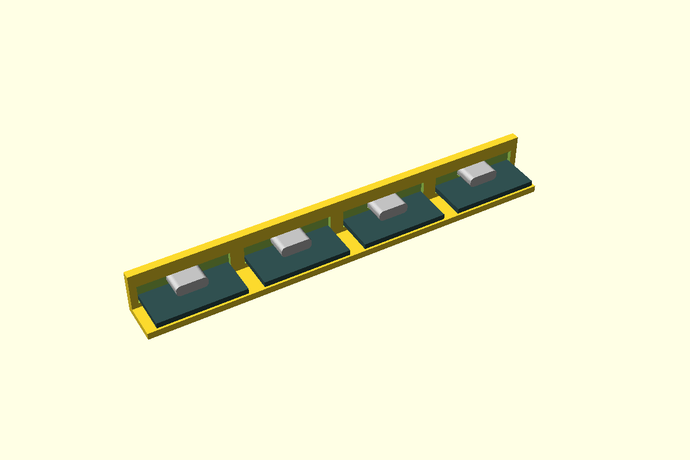

# USB-C port, flush in a wall

The board's USB-C socket sits in a close-fitting pocket in the wall, **walled in on all four
sides** with its face level with the outside. The cable seats the way it does on a laptop, and
you can't see into the box.

A socket only overhangs its board's edge by a millimetre or so, which is less than the wall. So
the board's end tucks into a shallow **relief** in the wall's inner face, the width of the board.
That leaves the wall round the socket just thick enough for its face to reach the outside.

If a socket overhangs less than `usbcMinWall` (1.0), the face sits back from the outside by the
difference instead of leaving a paper-thin wall. `usbcRecess(overhang)` gives that distance. The
S3 DevKitC's 0.38 overhang sits back 0.62.



**Status:** measured. Fit piece not yet printed.

## Use

```openscad
use <../lib/hardware-library/components/usb-c-port/usb-c-port.scad>

// frame: floor top, wall inner face, under the socket axis; +X into the box
translate([wallInnerX, usbY, floorTop])
  usbcWallCut(axisZ, wall = 2.4, overhang = 1.47, boardW = 25.4, pcb = 1.6);   // in the wall's difference()
// where the board's socket edge lands (negative: inside the wall): put the posts to match
edgeX = usbcBoardEdgeX(wall = 2.4, overhang = 1.47);   // -0.93
boardZ = usbcBoardZ(axisZ, pcb = 1.6);                 // board underside above the floor
```

`shift` moves the socket off the board's centre line, for example on the S3, which has two
ports. `aboveBoard` makes the relief taller if parts by the board's edge stand higher than the
socket.

## Dimensions

| Variable | Value | Source |
|---|---|---|
| `usbcShellW` × `usbcShellH` | 8.94 × 3.26 | USB-C receptacle shell, typical. The FireBeetle measures 3.2 tall. **CAL** on each board |
| `usbcShellR` | 1.2 | **CAL**: the shell's end radius. A full round would be 1.63 |
| `usbcShellDepth` | 7.35 | Typical; ghost only |
| Overhang past the board edge | FireBeetle 1.47, C3 Super Mini 1.5, S3 (YD) 0.38 | STEP models (the controller project's parts sheet) |

## Design values

| Variable | Value | Why |
|---|---|---|
| `usbcClearance` | 0.15 per side | CAL: shell to pocket. Set by the fit piece |
| `usbcMinWall` | 1.0 | Thinnest wall left round the socket |
| `usbcReliefGap` | 0.3 | Board relief over the board, all round |
| `usbcChamfer` | 0.3 | Lead-in on the outside edge, so a plug finds the socket |

## Fit piece

`make usb-c-port` → `out/usb-c-port_fit.3mf`. A strip of 2.4 wall with four pockets, set up for
the FireBeetle. The C3 Super Mini fits the same relief.

| Dots | Gap per side |
|---|---|
| 1 | 0.10 |
| 2 | 0.15 |
| 3 | 0.20 |
| 4 | 0.30 |

Checks:
- Hold the board level and slide its socket in from behind. It should go in with a light push
  and not rattle.
- Is the face flush with the outside?
- Plug a cable in from the front. Does it seat fully?

## Results

| Date | Material | Best | Notes |
|---|---|---|---|
| — | | | |
