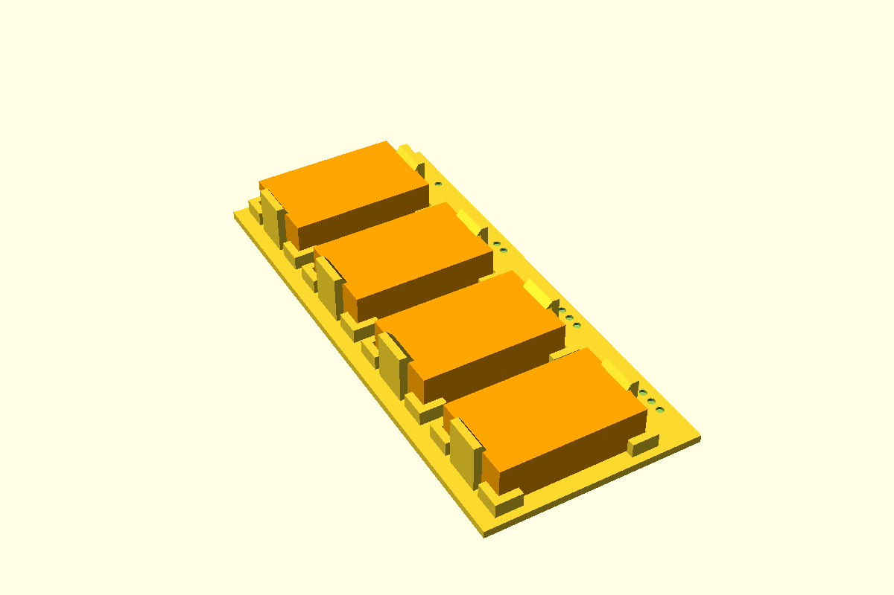

# WAGO 221 lever connector, snap clip

A WAGO 221 lever connector held flat on the floor of the box. **Push it down:** it presses on
the sloped lead-ins of two arms at its short ends, the arms flex outward, and their hooks snap
over its top edge. L-shaped stops at the corners locate the footprint. The wire-entry face is left
open, with only a 1 mm stub at each corner so the outer ports stay clear. To take it out, prise
one hook back with a fingernail and lift.

The arms stand free of the stops, so they flex from the floor. Open the levers with the WAGO out
of the clip: they swing up to about 20 above the floor.

First used in the controller project (controller base ground bus, a 221-425, 2026-11-02).



**Status:** measured. Fit piece not yet printed.

## Use

```openscad
use <../lib/hardware-library/components/wago-221/wago-221.scad>

// frame: floor top, centre of the WAGO's footprint; wire entries face -X
translate([x, y, floorTop])
{
  wagoClip("221-415");
  if ($preview) wagoGhost("221-415");
}
echo(wagoClipHeight("221-415"));   // 10.0: clear this under the lid
```

`wagoLength(name)`, `wagoDepth(name)`, `wagoHeight(name)` give the body, for placing it. The
clip needs `depth + 2 × 2.0` by `length + 2 × 2.0` of floor, and the wires need the strip length
plus their bend in front of the entry face: allow 15 for 4 mm², 20 for 6 mm².

## Sizes

Select by item number. Length is along the row of levers (Y), depth from the entry face to the back (X).

| Name | Ways | Max | L × D × H (levers closed) | Strip | Source |
|---|---|---|---|---|---|
| `221-412` | 2 | 4 mm² | 13.2 × 18.8 × 8.6 | 11 | WAGO data sheet 221-412, 03.10.2022 (2015 UK brochure: 13.1 × 18.6 × 8.3) |
| `221-413` | 3 | 4 mm² | 18.7 × 18.6 × 8.3 | 11 | WAGO UK 221 brochure. No data sheet found: **CAL** |
| `221-415` | 5 | 4 mm² | 30.0 × 18.6 × 8.4 | 11 | WAGO data sheet 221-415, 19.04.2025; matches the 221-425 measured in the controller project |
| `221-425` | 5 | 4 mm² | 30.0 × 18.6 × 8.4 | 11 | Green Range 415: measured (the controller project's base, 2026-10) |
| `221-612` | 2 | 6 mm² | 16.0 × 21.1 × 10.1 | 12–14 | WAGO data sheet 221-612, 12.05.2023 |
| `221-613` | 3 | 6 mm² | 22.9 × 21.1 × 10.1 | 12–14 | WAGO data sheet 221-613, 04.04.2025 |
| `221-615` | 5 | 6 mm² | 36.7 × 21.1 × 10.1 | 12–14 | WAGO data sheet 221-615, 07.04.2025 |

Data sheets read from distributor copies of WAGO's own sheets (Gescan, chipdip), 2026-11-02. The
heights differ by a few tenths between sheets of the same family (8.3 / 8.4 / 8.6), and the hook
sits only 0.2 over the top, so **CAL the height** of any size before relying on it. Height with
the levers open isn't published: about 20, **CAL**.

Add a size as a row of `wagoSizes`: `[name, length, depth, height, ports, strip, max mm²]`.

## Design values

| Variable | Value | Why |
|---|---|---|
| `wagoHook` | 0.7 | CAL: how far each hook reaches in over the top edge. Set by the fit piece |
| `wagoClearance` | 0.4 | Footprint to arms and stops, each side (controller base `fitClearance`) |
| `wagoHookGap` | 0.2 | WAGO top to the hook's flat underside |
| `wagoLeadIn` | 1.4 | Sloped lead-in above the hook: the WAGO pushes the arms apart on it |
| `wagoArmThick` × `wagoArmWidth` | 1.6 × 8 | PETG arm, flexes by the hook depth to let the WAGO in |
| `wagoStopH` / `wagoStopLeg` | 3 / 4 | Corner stops, along the ends and the back |
| `wagoEntryStub` | 1.0 | Stop along the entry face: short, so the outer port's wire clears it |

The controller base's clip (`wagoClip()` in `controller-base.scad`) put the hook's tip 0.7 past
the arm's face, which leaves only 0.3 over the WAGO after the 0.4 gap. Here `wagoHook` is the
reach over the WAGO itself.

## Fit piece

`make wago-221` → `out/wago-221_fit.3mf`. Four clips for a 221-415 on an open floor. Prints base
down, no supports, in the enclosure's material. Set `name` in `fit.scad` for another size.

| Dots | Hook | Clearance |
|---|---|---|
| 1 | 0.4 | 0.4 |
| 2 | 0.7 | 0.4 |
| 3 | 1.0 | 0.4 |
| 4 | 0.7 | 0.2 |

For each: push the WAGO down. Do both hooks snap over? Does it sit without rattling? Lift it by
the levers: does it stay put? Can you prise a hook off and take it out without breaking an arm?
Write the winner into `wagoHook` / `wagoClearance` and the results table below.

## Results

| Date | Material | Best | Notes |
|---|---|---|---|
| — | | | |
